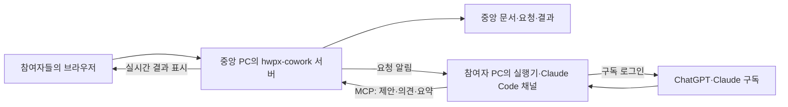

# 중앙 서버·외부 접속·AI 연결 운영 매뉴얼

작성 2026-10-26, 2026-11-13 개편. 중앙 서버 설치, 다른 PC에서 접속하기, AI 연결의 운영 절차다. AI 연결은 사용 설명서와 같은 순서로 안내한다: **① 내 PC의 구독 AI(Codex·Claude Code — 기본, 추가 비용 없음) → ② ChatGPT 웹(고급) → ③ API 키(선택, 유료)**.

**프로그램 안에서 읽기:** 로그인 화면·문서 목록·문서 상단의 **사용 설명서**를 누르면 작업 화면 위에 설명서가 열린다. 관리자는 상단 **상세 운영 매뉴얼**에서 이 문서 전문을 읽는다. **닫기** 또는 Esc로 돌아오면 편집기와 작성 중인 AI 요청이 유지된다.

## 서버 주소만 바꾸려면

1. 서버 PC의 프로그램 폴더에서 `npm start`로 실행한다(클릭으로 쓰는 PC는 Windows 앱의 '여러 사람과 함께 쓰기').
2. **관리자 토큰으로 로그인 → 상단 관리자**를 연다. 일반 사용자에게는 이 버튼이 보이지 않는다.
3. **접속 범위**, **포트**, 필요한 경우 **외부 공유 주소**를 입력하고 **저장하고 재시작 → 확인하고 재시작**을 누른다. 설정만 미리 저장할 수도 있다.
4. 같은 주소이면 새 서버의 응답을 확인하고, 포트 등이 바뀌면 표시된 새 주소에서 다시 로그인한다. 접속 토큰을 새 주소로 자동 전달하지 않는다.

진행 중인 저장·서버 AI 작업을 마친 뒤 재시작한다. 사용할 수 없는 포트는 재시작 전에 거절하며, 새 서버가 시작에 실패하면 이전 연결 설정으로 한 번 복구한다. 환경 변수로 고정한 항목은 웹에서 잠긴 상태로 표시된다. `node server/index.js` 직접 실행은 웹 재시작을 지원하지 않으므로 운영할 때는 `npm start`(= `node server/launcher.js`)를 사용한다.

`npm start`를 띄운 창에서 Ctrl+C로 끄면 자동 복구도 멈추므로 다시 켤 때는 `npm start`를 다시 실행한다. 예전 `start-server.bat`·`stop-server.bat`·`start-https.bat`은 2026-11-17에 지웠다 — 서버 감시 작업은 bat 이 아니라 `node server/launcher.js`(HTTPS 앞단은 `node https/run-https.mjs`)를 직접 부른다.

**외부 공유 주소는 이미 준비한 주소를 안내하는 설정이다.** 인터넷에서 접속하려면 도메인·HTTPS 프록시나 터널과 방화벽을 별도로 준비한다(§4). 준비가 끝나면 관리자 화면의 LAN 주소 후보나 외부 공유 주소를 참여자에게 전달한다.

## 1. 어느 PC에 무엇을 설치하나요?

| 하고 싶은 일 | 중앙 서버 PC | 참여자 PC |
|---|---|---|
| 문서 열기·공동 편집·메모·AI 요청 | 프로그램·Node.js 실행 | 브라우저만 필요 |
| ① 내 구독 AI로 바로 처리(기본) | 요청 알림과 `/mcp` 제공(이미 있음) | Windows 앱('AI 실행기만' 방식 + [AI → 실행기 관리…] → '다른 서버'), 또는 Codex·Claude Code 실행기(`npm run worker`)·Claude Code 채널 + 토큰 환경 변수 |
| ① VS Code·CLI 대화창에서 처리 | 같은 `/mcp` | `codex mcp add`·`claude mcp add`로 한 번 등록 |
| ② ChatGPT 웹에서 처리(고급) | 공개 HTTPS 주소와 OAuth | 브라우저(ChatGPT 계정)만 |
| ③ API 키로 처리(선택·유료) | 내 AI 키 보관 또는 공용 서버 AI | 브라우저만, 또는 개인 API 실행기·API 키 |

프로그램 전체를 모든 참여자 PC에서 실행할 필요는 없다. **MCP 서버도 중앙 PC에 이미 있으므로 사람마다 새로 만들지 않는다.** 참여자마다 다른 것은 사용자 토큰과 선택한 AI 계정이다. 실행기·채널은 중앙 서버에 연결하는 클라이언트이며 별도 웹 서버를 열지 않는다.



## 2. 접속 주소 확인

| 위치 | 웹 주소 | MCP 주소 |
|---|---|---|
| 서버 PC 자신 | `http://localhost:8787` | `http://localhost:8787/mcp` |
| 같은 LAN에 있는 다른 PC | `http://서버PC의_LAN_IP:8787` | `http://서버PC의_LAN_IP:8787/mcp` |
| 인터넷의 다른 장소 | 준비한 HTTPS 주소(예: `https://cowork.example.com`) | `https://cowork.example.com/mcp` — ChatGPT OAuth에는 공개 HTTPS가 필요 |

LAN 주소는 DHCP·VPN·네트워크 변경에 따라 달라지고, 다른 PC의 실제 접속과 Windows 방화벽은 따로 확인해야 한다. 가상 네트워크를 포함해 여러 IP가 있는 PC라면 목록의 첫 IP를 무조건 공유하지 않는다. `0.0.0.0`은 수신 설정이며 브라우저에 입력할 주소가 아니다. `localhost`는 주소를 여는 각자의 PC를 뜻하므로 외부 참여자에게 공유하지 않는다.

현재 주소 확인(설정·방화벽을 바꾸지 않음):

```powershell
npm run connections
```

웹 설명서의 **공유 주소 점검**에서도 로그인 후 LAN 후보를 이름과 함께 확인하고 사용할 주소를 고를 수 있다. 서버를 다른 PC로 옮길 때는 [서버 이전 안내](SERVER_MIGRATION.md)를 본다.

## 3. 중앙 서버 운영자가 준비할 것

1. Node.js 22 이상을 권장한다. 프로그램 폴더에서 아래 명령을 실행한다(클릭 설치를 원하면 Windows 앱의 '여러 사람과 함께 쓰기').
2. `config.json`의 `users`에 참여자마다 다른 이름·토큰·역할을 등록한다(웹 **관리자 → 사용자**에서도 됨). 예시 파일의 `change-me-*` 토큰은 실제 배포에 사용하지 않는다.
3. 참여자에게 **웹 주소와 본인의 토큰을 따로** 전달한다. 관리자 토큰을 공동 사용하지 않는다.
4. 서버 PC와 서버 프로세스는 사용 시간 동안 켜 둔다. 절전·종료·네트워크 변경 시 접속이 끊긴다.

```powershell
npm.cmd install
npm run build:studio
npm start
```

토큰 생성 예(관리자가 설정에 입력할 새 값 생성):

```powershell
node -e "console.log(require('crypto').randomBytes(24).toString('base64url'))"
```

LAN 수신 설정:

```json
{ "host": "0.0.0.0", "port": 8787 }
```

다른 PC에서 접속이 안 되면 같은 네트워크인지, 올바른 인터페이스 IP인지, 서버가 실행 중인지 확인한다. 필요할 때 관리자가 **사설 네트워크·같은 서브넷**에 한정한 방화벽 규칙을 검토할 수 있다(관리자 PowerShell용, 프로그램이 자동 실행하지 않음):

```powershell
New-NetFirewallRule -DisplayName "hwpx-cowork LAN" -Direction Inbound -Action Allow -Protocol TCP -LocalPort 8787 -Profile Private -RemoteAddress LocalSubnet
```

문서 읽기 범위는 문서함의 폴더·문서 권한이 정하고, 문서 설정은 수정 권한을 정한다. 서버 자체를 팀별로 나눠야 하면 서버·데이터 공간을 분리해 운영한다.

## 4. 인터넷의 다른 장소에서 접속하기

LAN의 사설 주소는 일반 인터넷에서 직접 접속하는 주소가 아니다. 아래 중 하나를 운영자가 구성한다.

### A. 정해진 참여자끼리 VPN으로 연결

참여자와 서버 PC가 같은 VPN에 들어온 뒤 서버의 VPN 주소로 접속한다. 예를 들어 Tailscale을 설치·로그인하고 접근 권한을 정한 후 서버에서 HTTPS 프록시를 구성할 수 있다:

```powershell
tailscale serve --bg http://127.0.0.1:8787
```

명령이 표시한 실제 HTTPS 주소를 참여자에게 전달한다. 접속자는 해당 VPN에 연결되어 있어야 한다. [Tailscale Serve 공식 문서](https://tailscale.com/docs/reference/tailscale-cli/serve).

### B. 외부 브라우저에서 접속할 HTTPS 주소 제공

서버 PC에서 Tailscale Funnel의 계정·관리 정책 조건을 준비한 후 공개 프록시를 구성할 수 있다:

```powershell
tailscale funnel --bg 8787
```

출력된 `https://장치명.테일넷명.ts.net` 형태의 **실제 발급 주소**가 웹 주소이고, 그 뒤 `/mcp`가 AI 연결 주소다. 방문자가 Tailscale을 설치할 필요는 없지만 앱의 개인 토큰 로그인은 계속 필요하다. [Funnel 명령](https://tailscale.com/docs/reference/tailscale-cli/funnel), [인터넷 공유 안내](https://tailscale.com/docs/use-cases/application-testing/share-local-dev-server-with-internet).

도메인과 서버를 운영한다면 Caddy 같은 HTTPS 역방향 프록시도 사용할 수 있다. [deploy/Caddyfile.example](../deploy/Caddyfile.example)은 고정 도메인용 예제다. DNS와 인증서·라우팅 조건을 준비해야 하며, 예제 도메인은 실제 접속 주소가 아니다. WebSocket과 실시간 알림 스트리밍을 전달해야 공동 편집·자동 AI 알림이 작동한다. [Caddy 프록시 공식 문서](https://caddyserver.com/docs/caddyfile/directives/reverse_proxy).

**임시 주소: Cloudflare Quick Tunnel (`npm run tunnel`)** — 계정·도메인 없이 `https://…trycloudflare.com` 주소를 연다. 처음 한 번 `winget install --id Cloudflare.cloudflared -e`로 설치하고 프로그램 폴더에서 `npm run tunnel`(= `scripts/quick-tunnel.mjs`)을 실행한다(예전 `start-tunnel.bat`은 2026-11-17에 지웠다. Windows 앱은 [함께 쓰기 → 외부 접속 열기]). 서버가 꺼져 있으면 먼저 켜고, 발급 주소를 공유 주소(`publicUrl`)로 저장한 뒤 서버를 다시 시작한다. 창을 닫거나 Ctrl+C를 누르거나 터널이 끊기면 공유 주소를 비워 로컬로 되돌린다.

**Quick Tunnel 제한(Cloudflare 공식):** 켤 때마다 주소가 바뀌고(ChatGPT 연결은 새 주소로 다시 만든다), 동시 요청 200개, 오래 열어 두는 스트리밍 미지원, 가동 보장 없음. 그래서 원격 참여자의 Claude 채널 알림·실행기 알림 스트림은 쓰지 못한다(서버 PC의 실행기·채널은 `localhost`로 붙으므로 영향 없음). 고정 주소와 스트리밍이 필요하면 도메인을 연결한 정식 Tunnel로 옮긴다. [공식 제한](https://developers.cloudflare.com/cloudflare-one/networks/connectors/cloudflare-tunnel/do-more-with-tunnels/trycloudflare/).

발급한 외부 주소를 프로그램 안내에도 반영하려면 서버를 시작할 터미널에서 환경 변수를 설정한다:

```powershell
$env:HWPX_COWORK_PUBLIC_URL = 'https://발급받은-실제-호스트'
npm start
```

또는 `config.json.publicUrl`(관리자 화면의 외부 공유 주소)에 같은 기본 주소를 기록하고 재시작한다. 토큰·`/mcp`·쿼리 문자열은 기본 주소에 넣지 않는다. 주소를 적는 것만으로 터널·DNS·방화벽이 구성되지는 않는다. 다른 네트워크(휴대폰 데이터망 등)에서 웹 로그인, 두 브라우저 동기화, AI의 요청 수신을 확인한다.

## 5. 참여자의 기본 사용

1. 받은 웹 주소를 브라우저로 열고 **본인 토큰**으로 로그인한다.
2. 글을 고르거나 문단에서 우클릭 → **AI에게 맡기기**에 할 일과 첨부를 넣어 보낸다(비우면 검토). **AI에게 빠르게 맡기기**는 예시 지시로 바로 보낸다.
3. 결과는 AI 작업 탭과 문서 옆에 표시된다. 권장안은 기본 하나이고, 비교를 원할 때만 여러 안을 요청한다.
4. 사람이 결과를 확인해 반영한다. 실시간 문서는 바로 공유되고, 승인 방식은 수정본·검토 요청 흐름을 따른다.

처리할 AI(실행기·채널·내 AI 키·서버 AI)가 없으면 요청은 대기열에 남고, 대화창에서 “대기열을 처리해 줘”라고 할 때 처리된다. 메모 설정 `남기지 않음`은 신규 자동 작업기록만 생략하고 AI 작업 탭에는 결과를 보관한다.

## 6. AI 연결 순서 — 기본은 내 PC의 구독 AI

참여자 사용 설명서(`/help.html#ai`, 2026-11-13 개편)는 이 순서로만 안내한다. ① 내 PC의 구독 AI가 기본이고 추가 비용이 없다. ② ChatGPT 웹은 공개 HTTPS가 있을 때만 쓰는 고급 방법이다. ③ API는 구독과 별도로 요금이 들므로 마지막에 둔다. ChatGPT 이벤트 구독(MCP Events)과 Work 예약 점검은 반응이 느리고 조직 권한상 막아 두어 안내하지 않는다(서버 기능은 남아 있음 — [MCP Events 안내](/manual-resources/MCP_EVENTS_GUIDE.md)). 설정·상태·실패 복구는 [자동 처리 안내](/manual-resources/AUTOMATIC_AI_GUIDE.md).

| 순서 · 연결 | 한 번 설정 | 새 요청 처리 | 비용 |
|---|---|---|---|
| ① Codex 실행기 | `codex login`, Windows 앱 [AI → 실행기 관리…] 또는 토큰 환경 변수 + `npm.cmd run worker -- --provider codex` | 실행 중 알림으로 바로 | ChatGPT 구독 사용량 |
| ① Claude Code 실행기 | `claude auth login`, Windows 앱 [AI → 실행기 관리…] 또는 토큰 환경 변수 + `npm.cmd run worker -- --provider claude-code` | 실행 중 알림으로 바로 | Claude 구독 사용량 |
| ① Claude Code 채널 | `claude` 로그인, 토큰 환경 변수, `start-agent.bat` | 채널 세션 실행 중 바로 | Claude 구독 사용량 |
| ① Codex·Claude Code 대화(VS Code·CLI) | `codex mcp add` · `claude mcp add`(아래) | “대기열을 처리해 줘”라고 할 때 | 구독 사용량 |
| ② ChatGPT 웹 | OAuth 연결(§9) | 대화에서 말할 때 | 구독 사용량 |
| Gemini CLI MCP | `httpUrl`+인증 헤더(§8) | 대화에서 말할 때 | 계정 정책 |
| ③ 내 AI 키 | 문서 목록 **내 AI 키**에 키 저장(§10) | 서버가 요청자 키로 즉시 | **유료** API |
| ③ 개인 API 실행기 | 실행기 ZIP + API 키(§7) | 실행 중 바로 | **유료** API |
| ③ 공용 서버 AI | 관리자 설정(§10) | 서버가 즉시 | **유료**(서버 계정) |

여기서 **자동 처리**는 웹의 요청을 받아 제안·의견·요약을 돌려주는 것이다. 웹 대화창에 메시지를 강제로 입력하거나, 사람의 본문 반영 결정을 대신하는 기능은 아니다. MCP 연결만으로는 새 요청이 AI에게 자동 전달되지 않는다 — 실시간은 실행기·채널이 맡는다.

### VS Code·CLI에 MCP 등록

Codex CLI와 VS Code의 Codex 확장은 같은 `~/.codex/config.toml`을, Claude Code CLI와 VS Code 확장은 같은 사용자 설정을 쓴다. 토큰은 먼저 사용자 환경 변수에 저장한다(`setx HWPX_COWORK_TOKEN "내-토큰"`, 새로 연 창부터 보임). 주소는 실제 서버 주소로 바꾼다 — 웹 설명서에는 이 서버의 주소로 채워진 명령이 복사 단추와 함께 나온다.

```powershell
codex mcp add hwpx --url "https://cowork.example.com/mcp?agent=Codex" --bearer-token-env-var HWPX_COWORK_TOKEN
claude mcp add --scope user --transport http hwpx 'https://cowork.example.com/mcp' --header 'Authorization: Bearer ${HWPX_COWORK_TOKEN}'
```

Codex 등록 결과(`config.toml`에 직접 넣어도 같다, 값 대신 환경 변수 이름만 기록):

```toml
[mcp_servers.hwpx]
url = "https://cowork.example.com/mcp?agent=Codex"
bearer_token_env_var = "HWPX_COWORK_TOKEN"
```

Claude Code는 작은따옴표 안의 `${HWPX_COWORK_TOKEN}`을 글자 그대로 저장하고 연결할 때 환경 변수 값으로 바꾼다(2026-11-13 Claude Code 2.1.322, 격리 설정에서 맞는 토큰은 연결·틀린 토큰은 401 확인). `?agent=Codex`는 메모 작성자 표기용이다(Claude Code는 클라이언트 이름으로 자동 표기). 표준 초기화를 하는 MCP 클라이언트는 `Mcp-Session-Id`로 대화별 선점을 나눈다.

**연결 종류(2026-11-17부터).** 위 주소를 그대로 등록하면 새 연결(v2) — `task`·`read`·`edit`·`finish`와 문서 목록·새 문서·반영·메모·변경 요청 도구(36개)다. “대기열을 처리해 줘”는 인자 없는 `task`를 none까지 되풀이하고 요청마다 `edit`(done)·`finish`로 끝낸다. 요청 없이 직접 시키면 `list_documents` → `read` → `edit`(request_id 없이). 예전 도구(`claim_next_request`·`propose_*` 등)가 필요하면 주소에 `?v=1`을 붙인다(Codex는 `…/mcp?agent=Codex&v=1`). 서버 전체를 예전 연결로 되돌리려면 `config.json`에 `"mcp": { "defaultSurface": "v1" }`을 넣고 재시작한다 — 이미 배포된 옛 실행기·브리지(이름이 `hwpx-`로 시작)는 이 설정 없이도 예전 연결로 열린다. 지금 서버의 기본은 `/api/config`의 `features.mcpDefault`로 본다.

## 7. 소형 개인 실행기(ZIP) — 구독 Codex·Claude Code 먼저, API는 유료

웹 설명서 ① 절의 **실행기 ZIP 내려받기**로 소형 ZIP을 받는다(문서 화면에 로그인한 상태). ZIP에는 실행 코드와 의존성 목록만 들어 있고 중앙 문서·설정·토큰은 포함하지 않는다. 서버 관리자는 `npm run package:worker`로 같은 ZIP을 만들 수 있다. 압축을 푼 폴더에서 Node.js를 준비하고 `npm.cmd install`을 실행한다. 서버 프로그램을 다시 시작할 필요는 없다.

공통 설정(같은 PowerShell에서, 주소는 실제 서버 MCP 주소, 토큰은 `setx`로 저장했으면 생략):

```powershell
$env:HWPX_COWORK_URL = 'https://cowork.example.com/mcp'
$env:HWPX_COWORK_TOKEN = '관리자가-발급한-내-토큰'
```

### Codex — ChatGPT 구독(기본, 추가 비용 없음)

```powershell
npm.cmd run worker -- --provider codex --check
npm.cmd run worker -- --provider codex
```

`codex login`으로 ChatGPT 계정에 로그인한 상태여야 한다. Windows 앱(0.6.0부터)이면 [AI → 실행기 관리…]에서 Codex 실행기를 더해 켠다(다른 PC의 서버면 '다른 서버' — 주소 + 내 토큰. 이 PC에 서버가 필요 없으면 앱 처음 실행에서 'AI 실행기만'). 예전 `start-codex-agent.bat`은 2026-11-17에 지웠다. 실행기는 MCP v3가 기본이고, `--mcp 2`이면 v2, `--mcp 1`(또는 `HWPX_COWORK_MCP=1`)이면 예전 연결이다 — 옛 중앙 서버(새 연결을 모름)면 시작 점검에서 멈추고 `--mcp 1`을 알린다. 자세한 동작·모델 선택·복구는 [자동 처리 안내](/manual-resources/AUTOMATIC_AI_GUIDE.md).

### Claude Code 실행기 — 바로 처리(기본)

최신 Claude Code에서 `claude auth login`으로 구독 로그인한다. Windows 앱이면 [AI → 실행기 관리…]에서 Claude Code 실행기를 켠다. 명령줄은 토큰 환경 변수를 저장하고 프로그램 폴더(실행기 ZIP이면 `npm.cmd install` 뒤)에서 다음 명령을 쓴다(예전 `start-claude-worker.bat`은 2026-11-17에 지웠다).

```powershell
$env:HWPX_COWORK_URL = 'https://cowork.example.com/mcp'
npm.cmd run worker -- --provider claude-code --check
npm.cmd run worker -- --provider claude-code
```

실행기가 요청마다 `claude -p`와 제한된 임시 MCP 연결을 준비하므로 사용자 MCP 등록·채널 허용 없이 쓴다. API 키 로그인은 받지 않는다. `--check`는 모델 호출·문서 변경 없이 연결과 로그인만 점검한다. 자세한 준비와 제한은 [Claude Code 안내](AGENT_SETUP.md) §0을 따른다.

### API 제공자 — 유료(선택)

아래는 구독과 별도로 API 요금이 든다. 계정에서 사용 가능한 모델을 확인하고 바꾼다.

```powershell
$env:OPENAI_API_KEY = '내-OpenAI-API-키'
npm.cmd run worker -- --provider openai --model gpt-4.1-mini
```

```powershell
$env:ANTHROPIC_API_KEY = '내-Anthropic-API-키'
npm.cmd run worker -- --provider anthropic --model '계정에서-사용할-Claude-모델-ID'
```

```powershell
$env:GEMINI_API_KEY = '내-Gemini-API-키'
npm.cmd run worker -- --provider gemini --model '계정에서-사용할-Gemini-모델-ID'
```

OpenAI는 Responses API, Gemini는 `generateContent` REST를 쓴다. 구조화 JSON 출력과 필요한 첨부 입력을 지원하는 모델을 고른다. [OpenAI 구조화 출력](https://developers.openai.com/api/docs/guides/structured-outputs?api-mode=responses), [Gemini 생성 API](https://ai.google.dev/api/generate-content).

**MCP 연결(2026-11-17부터 새 연결이 기본).** API 실행기는 기본 v3 또는 `--mcp 2`로 실행하면 요청을 맡아 요청 내용(brief)을 첫 입력에 싣고, 모델에게 도구 7개(`read`·`edit`·`finish` + `preview_figure`·`export_figure`·`read_skill_resource`·`export_skill_resource`)만 준다. 모델이 `edit`로 결과를 저장하고 `edit`의 `done`이나 `finish`로 끝내면 그 자리에서 멈춘다. 도구 없이 글로만 답하면 두 번 재촉하고, 그래도 끝내지 않으면 `API_MCP_INCOMPLETE`로 실패로 알린다(그때까지 저장한 제안·메모는 남는다). 토큰 사용량은 요청 기록에 남는다. 예전 길(도구 26개 + 최종 JSON — 위의 구조화 출력이 필요한 쪽)은 `--mcp 1`(또는 `HWPX_COWORK_MCP=1`). 서버 AI·서버에 등록한 개인 키·체험 공유 키는 `config.ai.mcp`(기본 `"v3"`, `"v2"`는 문단 보기, `"v1"`이면 예전 길 — 서버 재시작 필요)를 따른다. 새 연결에는 선택 서식 자동 보충·`instructionSummary`·`ai.documentContext`·표준서식 지침을 시스템 글에 싣기(필요하면 모델이 `read view='guide'`)·`maxProposals`가 없다. **실제 유료 API로는 아직 확인하지 않았다**(가짜 fetch 시험 `tests/api_mcp_v2.test.mjs`). 새 연결은 도구 정의(36개 13,616 → 7개 3,279토큰, o200k 추정)와 지침(3,468 → 1,096)이 작아, 호출마다 다시 보내는 고정 글이 약 1만 7천 → 4천 4백 토큰이 된다(모델 없이 잰 값).

### API 게이트웨이 경유(`--gateway baze`)

BAZE API 게이트웨이에서 발급한 키 하나로 OpenAI·Claude·Gemini 모델을 쓴다. `--gateway baze`를 붙이면 제공자별 호환 주소를 쓴다.

| provider | API 주소(자동) | 인증 |
|---|---|---|
| openai | `https://api.baze.co/v1/gateway/responses` (Responses API) | `Authorization: Bearer` |
| anthropic | `https://api.baze.co/v1/gateway/claude/v1/messages` | `x-api-key` |
| gemini | `https://api.baze.co/v1/gateway/gemini/v1beta/models/<모델>:generateContent` | `Authorization: Bearer` |

```powershell
$env:BAZE_API_KEY = '게이트웨이에서-발급한-API-키'
npm.cmd run worker -- --provider openai --gateway baze --model gpt-6.1-sol --effort medium
```

- 키는 `BAZE_API_KEY`에서만 읽는다. `OPENAI_API_KEY` 같은 제공자 키나 키 파일은 게이트웨이로 보내지 않는다.
- 모델 ID는 게이트웨이 모델 목록(`GET https://api.baze.co/v1/gateway/models/`, 같은 키로 조회)의 이름이다. 사용료는 게이트웨이 크레딧으로 차감된다. 크레딧은 키가 아니라 계정의 월 할당이고, 잔액·사용량은 과금 없는 `GET /v1/gateway/credits/`·`GET /v1/gateway/usage/?from=YYYY-MM-DD&to=YYYY-MM-DD&by=day|key|model&scope=key|member`로 보며, 서버에 등록한 키는 웹 **관리자 설정 > AI 크레딧**에서 본다.
- `--effort`는 OpenAI 추론 모델(`reasoning.effort`)과 Claude(`output_config.effort`)에 보낸다. 추론이 없는 OpenAI 모델과 Gemini에는 보내지 않는다.
- 다른 호환 게이트웨이는 `--base-url <주소>`와 `--key-env <키 환경 변수 이름>`으로 지정한다. `--key-env` 없이 `--base-url`만 주면 시작하지 않는다(환경의 다른 키가 다른 주소로 가지 않게).

실행 뒤 문서 화면의 보낼 곳과 AI 작업 탭을 확인하고 요청 한 건을 보낸다. 실행기는 자기 요청만 오래된 순서로 처리하고, 주기적으로 선점을 갱신하며, 취소된 요청의 늦은 결과는 쓰지 않는다. API 오류는 **실패**로 표시하므로 키·모델·사용 한도를 고친 뒤 **다시**를 누른다(무한 자동 재시도 없음). Ctrl+C로 종료한다. 같은 사용자 토큰에는 실행기 하나를 우선 사용한다 — 여러 실행기가 같은 요청을 각각 검토하는 방송 기능은 아니다.

## 8. Claude Code 채널과 Gemini CLI

### Claude Code 채널 — 대화형 세션으로 처리

[AGENT_SETUP.md](AGENT_SETUP.md) 절차를 사용한다. 서버 PC의 프로그램 폴더라면 `start-agent.bat` 하나로 띄운다. 다른 PC에서는 중앙 서버 URL에 닿는 PC에서 브리지와 Claude Code를 실행한다(토큰은 `setx`로 저장).

```powershell
node scripts/setup-agent.mjs --url 'https://cowork.example.com/mcp'
cd agent
claude --dangerously-load-development-channels server:hwpx
```

조직 계정은 채널을 허용해야 하며 세션이 열려 있을 때 알림이 들어온다. [Claude Code 채널 공식 문서](https://code.claude.com/docs/en/channels).

### Gemini CLI MCP

Gemini CLI 설정의 예:

```json
{
  "mcpServers": {
    "hwpx": {
      "httpUrl": "https://cowork.example.com/mcp",
      "headers": { "Authorization": "Bearer ${HWPX_COWORK_TOKEN}" }
    }
  }
}
```

대화에서 “hwpx의 내 대기 요청을 task로 하나씩 맡아 처리해 줘”라고 요청한다(2026-11-17부터 `/mcp` 기본은 새 연결 — 주소를 `…/mcp?v=1`로 넣었으면 “claim_next_request로 처리해 줘”). MCP 설정 자체는 자동 수신 기능이 아니다. [Gemini CLI MCP 공식 문서](https://geminicli.com/docs/tools/mcp-server/).

## 9. ChatGPT 웹 연결(고급 · OAuth)

공개 HTTPS 주소가 있을 때만 쓰는 고급 방법이다. 연결한 Work 채팅에서 “대기열을 처리해 줘”라고 하거나 사용 설명서 ②의 처리 프롬프트(인자 없는 `task`로 오래된 요청부터 none까지 — 예전 연결 `?v=1`이면 `claim_next_request`)를 붙여 넣을 때 처리된다. 새 요청을 매번 말하지 않고 처리하려면 ①의 Codex 실행기를 켠다. [OpenAI MCP 연결](https://learn.chatgpt.com/docs/extend/mcp), [플러그인 인증](https://developers.openai.com/plugins/build/auth).

**참여자 PC에는 설치가 필요 없다.** 브라우저에서 자기 ChatGPT 계정과 HWPX 개인 토큰으로 연결한다. OAuth는 HWPX 계정의 접근 권한을 ChatGPT에 허용하는 절차다. HWPX 서버에 ChatGPT 비밀번호·OpenAI API 키를 입력하지 않는다.

**운영자: 공개 HTTPS 경로 준비**

1. 서버를 켠 채 고정 도메인의 HTTPS 프록시 또는 HTTPS 터널을 준비한다(§4). `/mcp`뿐 아니라 `/.well-known/*`, `/authorize`, `/register`, `/token`, `/revoke`, `/oauth/approve`, `/oauth.css`도 같은 공개 호스트에서 서버로 전달해야 한다. HWPX 웹도 같은 HTTPS 주소를 사용한다.
2. 관리자 화면의 **외부 공유 주소**를 실제 HTTPS 기본 주소로 저장하고 재시작한다(또는 `HWPX_COWORK_PUBLIC_URL`). `npm run tunnel`(임시 주소)은 이 저장·재시작까지 한다. `/mcp`나 토큰은 기본 주소에 넣지 않는다.
3. 다른 PowerShell에서 점검한다.

```powershell
cd <프로그램 폴더>
npm.cmd run oauth:check -- --url https://실제로-발급된-호스트
```

점검 통과는 메타데이터·주소·인증 발견 경로 확인이다. 외부 네트워크에서 웹을 열고 실제 ChatGPT 연결과 도구 호출까지 해야 운영 검증이 끝난다. 단기 터널 주소가 바뀌면 공유 주소도 바꾸고 ChatGPT 연결을 새로 만든다. 프록시가 자체 로그인 화면·봇 차단·HTML 경고 페이지로 MCP 요청을 가로채지 않는지 확인한다.

**참여자: ChatGPT에서 연결**

1. 본인 ChatGPT에서 [플러그인](https://chatgpt.com/plugins)을 연다. `＋ → Add custom MCP server`를 선택한다. 메뉴가 없거나 차단되면 계정/워크스페이스의 사용자 지정 MCP 권한을 확인한다.
2. 이름 `HWPX 공동 검토`, 서버 주소 `https://실제-호스트/mcp`, 인증 `OAuth`. 등록 방식이 보이면 `DCR`, Client ID·Secret은 비운다.
3. 설치한 뒤 `Connect` → HWPX 인증 화면에서 **본인의 HWPX 접속 토큰**을 넣고 `인증하고 연결 허용`. 개인 토큰 원문은 ChatGPT로 가지 않고 별도 OAuth 토큰이 발급된다.
4. 대화에서 `@HWPX 공동 검토`를 고르고 “문서 목록을 보여 줘”로 연결을 확인한 뒤, “대기열을 처리해 줘”로 쌓인 요청을 처리한다. 결과는 웹의 AI 작업 탭에서 사람이 반영한다.

실제 UI 명칭·기능은 계정 정책에 따라 달라질 수 있다. [ChatGPT 사용자 지정 MCP 연결 공식 안내](https://developers.openai.com/api/docs/guides/custom-mcp-server).

**설정과 연결 해제**

OAuth는 올바른 HTTPS `publicUrl`이 있으면 기본 활성화된다. 공개 HTTP IP 주소에서는 활성화되지 않는다. 명시적 설정 예(전체 설정 파일을 이 조각으로 교체하지 않는다):

```json
"oauth": {
  "enabled": true,
  "redirectUris": [],
  "allowLoopbackClients": false
}
```

기본 콜백은 `https://chatgpt.com/connector_platform_oauth_redirect` 및 `https://chatgpt.com/connector/oauth/<callback_id>`다. ChatGPT 관리 화면에 표시된 실제 HTTPS 콜백이 다르면 `redirectUris`에 그 **정확한 주소**를 넣고 재시작한다. 임의 도메인·와일드카드는 넣지 않는다. 이 구현은 DCR, PKCE S256, authorization code, `none`/`client_secret_post` 인증을 지원하며 CIMD/OIDC 로그인은 제공하지 않는다.

액세스 토큰은 최대 1시간, 연결은 최대 30일이며 갱신 토큰은 사용할 때 교체된다. 서버 재시작 후에도 `data/oauth-state.json`으로 유지된다. 이 파일은 비공개 운영 자료(DCR 클라이언트 비밀정보와 토큰 지문)이므로 운영자만 접근하게 하고 외부에 배포하지 않는다. 공개 주소나 원본 사용자 토큰이 바뀌거나 사용자가 제거되면 다시 연결해야 한다.

HWPX에 본인 토큰으로 로그인하고 **사용 설명서 → ② ChatGPT 웹 → 내 ChatGPT 연결 보기·끊기**에서 연결을 끊으면 그 연결의 토큰을 즉시 폐기한다. ChatGPT에서도 플러그인 연결을 해제한다. OAuth 토큰은 `/mcp`에만 쓰고 관리자 REST API에는 허용하지 않는다. OAuth를 꺼도 개인 토큰 인증은 유지된다. OpenAI Secure MCP Tunnel도 전송 경로로 쓸 수 있지만 조직·워크스페이스 연결을 따로 준비해야 한다. [Secure MCP Tunnel](https://developers.openai.com/api/docs/guides/secure-mcp-tunnels).

## 10. API 키와 공용 서버 AI(선택 · 유료)

아래 방법은 구독과 별도로 API 요금이 든다. 참여자에게는 ① 내 PC의 구독 AI를 먼저 안내한다.

### 참여자 개인 키를 서버에 등록(내 AI 키)

참여자가 PC에 아무것도 설치하지 않고 **자기 API 키**로 처리받는 방식이다. 문서 목록 화면의 **내 AI 키**에서 연결(API · GPT/Claude/Gemini 모델, 개별 키가 있으면 각 제공업체 직접)·모델 ID·추론 강도·API 키를 저장하고 **연결 확인**을 누른다. 그 뒤 그 사람이 보낸 요청(채널·실행기가 없을 때)은 서버가 그 사람 키로 바로 처리한다. 관리자가 **다시**를 눌러도 요청자 키로 처리한다.

- 키는 `<dataDir>/personal-ai.json`에 AES-256-GCM 암호문으로 저장한다. 암호 열쇠는 `config.json` 옆 `.hwpx-cowork-secret`이다(데이터 폴더만 복사해서는 키가 풀리지 않음). 서버를 옮기거나 백업할 때는 `config.json`과 함께 이 파일도 옮기고, 남에게 주는 ZIP·공유 폴더에는 넣지 않는다. 서버 운영자는 서버 PC에서 키를 풀 수 있으므로 참여자가 운영자를 신뢰할 때 사용한다.
- 웹 API(`GET·PUT·DELETE /api/me/ai`)는 키를 다시 내보내지 않는다(끝 4자리만). **연결 확인**(`POST /api/me/ai/check`)은 모델 정보만 조회하며 생성 호출·과금이 없다.
- 연결 방식은 `direct`·`baze`·`local`을 받는다. `local`은 서버 PC의 `localhost`·`127.0.0.1`·`[::1]` 주소만 허용한다. 연결 방식이나 제공자를 바꾸면 키를 다시 넣어야 한다.
- `config.json.ai.personal=false`이면 이 기능을 끈다. 모의 AI(`HWPX_COWORK_AI_MOCK=1`)·`HWPX_COWORK_AI=off`에서는 개인 키로 실제 API를 부르지 않는다.

**로컬 AI(요금 없음):** **내 AI 키 → 연결 → 제공업체·로컬 API 직접 → 로컬 AI · OpenAI 호환 API**를 고르고, 로컬 API 주소(기본 `http://localhost:1234/v1`)와 LM Studio 등에 표시된 모델 ID를 넣는다. 키가 없는 로컬 서버면 키 칸을 비운다. 이 `localhost`는 **hwpx-cowork 서버가 실행되는 PC**다. 문서 작업은 `/responses`와 MCP 문서 도구 경로를 쓰므로 이를 지원하는 로컬 API가 필요하다.

### 공용 서버 AI

관리자가 중앙 서버에 공용 API 키를 제공하면 참여자는 브라우저만으로 자동 검토를 이용한다. 비용과 제공자는 중앙 서버 설정을 따른다. `config.json.ai` 설정 예(기존 `ai` 항목을 수정):

```json
"ai": {
  "enabled": true,
  "provider": "openai",
  "model": "gpt-4.1-mini",
  "keyEnv": "OPENAI_API_KEY",
  "mock": false
}
```

제공자는 `openai`, `anthropic`, `gemini` 중 고르고 모델·`keyEnv`도 그 제공자에 맞춘다. API 키는 서버를 시작할 환경에 설정한다. 게이트웨이 키를 쓰려면 `"gateway": "baze"`를 더하고 서버 환경에 `BAZE_API_KEY`를 둔다(예: `"provider": "openai", "model": "gpt-6.1-sol", "gateway": "baze", "effort": "medium"`). 다른 호환 게이트웨이는 `"baseUrl"`과 `"keyEnv"`를 함께 적는다(`keyEnv` 없이 `baseUrl`만 있으면 서버 AI가 꺼진다). 환경 변수 `HWPX_COWORK_AI_GATEWAY`·`HWPX_COWORK_AI_BASE_URL`·`HWPX_COWORK_AI_EFFORT`로도 덮어쓸 수 있다. `effort` 기본값(medium)은 Claude에만 적용되며, OpenAI는 적었을 때만 보낸다. 개인 에이전트가 연결되어 있으면 자동 경로는 그쪽을 먼저 쓰며, 공용 서버 AI를 쓰려면 요청 경로에서 서버 AI를 고른다.

**쓸 수 있는 계정 지정(2026-11-10):** 공용 키는 쓰는 만큼 비용이 나가므로 **관리자가 허용한 계정의 토큰으로 보낸 요청만** 서버 AI가 처리한다. 관리자 설정 → **사용자** 탭의 **서버 AI** 칸을 켠 계정만 허용되며(관리자 계정도 따로 켠다), 저장하면 재시작 없이 다음 요청부터 적용된다(`users[].serverAi: true`). 허용되지 않은 계정의 요청은 대기열로 가고 편집기도 서버 AI를 보낼 곳으로 보이지 않는다. 제한은 공용 키에만 건다 — 내 AI 키, 내 에이전트(MCP·채널), 체험 계정의 공유 연결에는 영향이 없다. `ai.restrictUsers`(true·false)로 정할 수 있고, 적지 않으면 실제 API 키가 있을 때만 제한한다.

`HWPX_COWORK_AI=off`는 공용 서버 AI를 끈다. `HWPX_COWORK_AI_MOCK=1`은 실제 API를 쓰지 않는 시험·체험용이다. 관리자 공용 키를 UI나 참여자에게 전달하지 않는다.

**MCP 연결 `ai.mcp`(2026-11-17):** 공용 서버 AI·서버에 등록한 내 AI 키·체험 공유 키는 적지 않으면 새 연결(`"v2"`)로 돈다 — §7 'MCP 연결'과 같은 도구 7개·끝 판정이다. 예전 길(도구 26개 + 최종 JSON, 선택 서식 자동 보충·`documentContext`·`maxProposals` 포함)이 필요하면 `"ai": { …, "mcp": "v1" }` 뒤 서버를 재시작한다. 모르는 값을 적으면 서버 AI를 켜지 않고 그 까닭을 알린다. 모의 AI·튜토리얼 예시 답변은 이 값과 관계없이 예전 길이다. 실제 유료 API로는 아직 확인하지 않았다.

### AI 수신 원문과 오류 판정 기록(2026-11-14)

AI 작업은 성공·실패 여부와 관계없이 수신 원문을 파일로 남긴다. JSON 해석이나 도구 입력 검사 **이전**에 저장하며, 기록 실패 시 `AI_DEBUG_WRITE_FAILED`로 처리를 중단한다. 기존 작업 메모의 짧은 오류 문구와 별도로, 아래 비공개 폴더에서 원문과 상세 판정을 확인한다. 파일을 자동으로 자르거나 회전·삭제하지 않는다.

| 경로 | 저장 위치와 내용 |
| --- | --- |
| 공용·개인 서버 API(OpenAI·Claude·Gemini·로컬 호환 API) | `<dataDir>/runtime/ai-debug/` — HTTP 응답 바이트(오류 본문·수신 중단 부분 포함), 제공자 요청 본문(인증 헤더 제외), 실제 파서 입력, 검증 결과 |
| 개인 API·Codex·Claude Code·Gemini CLI·Antigravity 실행기 및 협업 실행기 | 실행 폴더의 `logs/ai-debug/` — stdout/stderr 바이트, 처리 결과, MCP 호출/응답. CLI의 임시 작업 폴더와 분리하고 자식 MCP 브리지에도 영속 기록 폴더를 전달 |
| 서버 MCP(ChatGPT·Codex·Claude 채널·Desktop 등) | `<dataDir>/runtime/ai-debug/` — 수신 HTTP 본문, SDK 검사 전 도구 인자, 거절/반환 응답, 문서 엔진 상태 |
| 로컬 stdio·채널 브리지 | 실행 폴더의 `logs/ai-debug/` — 원시 stdin 바이트(잘못된 JSON 포함), 호출/응답, 채널 알림 |
| Claude 채널의 마지막 답변 | `agent/.claude/ai-debug-hook.mjs`가 Stop·StopFailure·SubagentStop·SessionEnd·MCP 도구 실패 시 hook 입력과 세션 transcript 사본을 저장. 마지막 답변은 `last_assistant_message`에서도 별도로 보존. 기본 `<프로그램>/logs/ai-debug/` |

개인 실행기/브리지/hook은 `HWPX_COWORK_DEBUG_DIR`로 기록 위치를 고정할 수 있다. 서버 기록은 해당 서버의 `dataDir`를 따른다. 기본 하위 구조는 `<문서ID>/r<요청번호>-a<시도>/<UTC시각>-<PID>-<실행UUID>/`이며, 요청 번호를 아직 모르는 연결·채널 transcript는 `unassigned`에 세션 ID로 남는다. `events.jsonl`이 원문 파일 경로·바이트 수·SHA-256·처리 단계·요청/시도/세션/모델을 연결한다. 스트림은 `stream.start`가 가리키는 `.bin`에 즉시 쓰고 `stream.end`에 최종 길이·해시·취소/실패 상태를 남긴다. 프로세스가 강제 종료돼 `stream.end`가 없으면 완전한 응답으로 간주하지 않고 남은 수신 바이트를 확인한다.

`result.validation.error`에는 `JSON.parse`/Claude 중첩 JSON 펼치기/`RunSchema`/서식 정규화 중 어느 단계에서 실패했는지와 원래 예외·스택·Zod 필드 경로가 들어간다. `state`는 **저장된 문서 버전·요청 상태와 현재 문서 캐시**의 출처를 명시하며 대상 문단 원문·시도·제안/메모 ID·트랜잭션 진행 여부를 담는다. 서비스의 최종 판정은 `service.request.failed`·`service.result.applied`에서 함께 확인한다. `run.start`에는 Node 판과 처리 코드 해시도 저장한다. MCP 프로토콜의 파싱된 JSON 객체 기록은 원시 HTTP/stdin 바이트 기록과 구분한다.

```powershell
node scripts/ai-debug.mjs --dir data/runtime/ai-debug --doc <문서ID> --request <요청번호>
node scripts/ai-debug.mjs --dir logs/ai-debug --session <세션ID>
```

명령은 파일 경로·해시 일치 여부·검사 단계·오류 상세를 출력하며 모델을 호출하거나 문서를 변경하지 않는다. 원문 파일은 `.txt`·`.json`·`.bin`으로 저장한다. `.bin`은 바이트 보존용 확장자이며 HTTP/CLI JSON·글은 UTF-8로 읽을 수 있다. 기록에는 문서와 응답 원문이 있으므로 공유용 메모·공개 웹 경로·배포 ZIP에는 넣지 않는다. 인증 헤더/실행 환경 전체는 기록하지 않는다.

외부 앱의 대화창에만 표시되고 hwpx-cowork에 전달되지 않는 글은 서버 MCP 수신 원문에 포함되지 않는다. Claude 채널은 위 hook으로 마지막 답변까지 보완하고, 관리하는 Codex·Claude CLI 실행기는 stdout 전체를 보존한다. 연결된 앱이 제공하지 않는 내부 추론을 수신한 것으로 기록하지 않는다.

서버 코드는 정상 재시작 뒤, CLI/브리지는 다시 실행한 뒤 적용된다. Claude 채널 hook 설정도 세션에서 다시 읽어야 하므로 기존 세션에 자동 적용됐다고 간주하지 않는다. 재시도는 새 시도/실행 폴더를 만들고 이전 실패 증거를 유지한다. 시험은 `node --test tests/ai_debug.test.mjs`(가짜 API·CLI, 임시 문서/서버)이며 실제 유료 호출은 하지 않는다.

Claude hook 필드는 [Claude Code 공식 hook 문서](https://code.claude.com/docs/en/hooks)를 따른다. Stop 시점 transcript에 최종 답변이 아직 없을 수 있으므로 `last_assistant_message`를 별도로 저장한다.

## 11. 검증 결과

| 상태 | 내용 |
|---|---|
| 구현 | 현재 주소·LAN 후보·외부 주소 진단, 원격 브라우저의 localhost 잘못 복사 방지, 다중 NIC 직접 선택 |
| 구현 | 로그인·목록·문서 화면에서 열 수 있는 사용 설명서, 개인 실행기 소형 ZIP |
| 구현 | Codex(ChatGPT 구독)·Claude Code(Claude 구독) 실행기·Claude Code 채널, OpenAI·Anthropic·Gemini API 실행기, 공용 서버 AI 제공자 선택 |
| 구현 | 요청 선점·직렬 처리·갱신·연결 복구·취소·실패 기록·부분 결과 중복 비교 |
| 구현 | ChatGPT 웹용 OAuth 2.1(DCR·PKCE), 개인 토큰 인증·동의 화면, 갱신·연결 해제 |
| 구현(2026-11-17, 로컬 검증 — 운영 반영 전) | MCP 기본 연결 = 새 연결(v2), 실행기·브리지·서버 AI·API 실행기 v2 기본, Windows 앱 0.6.0 실행기 관리 — API v2 의 실제 유료 호출과 앱 실제 창은 미검증 |
| 운영자 준비 필요 | 실제 공개 도메인/VPN/터널·접근 권한·방화벽·DNS·실제 API 키와 모델 |
| 별도 개발 범위 | 브라우저 AI 대화창 강제 주입, 사용자 가입/초대 |

ChatGPT 호스트가 같은 작업에서도 MCP 전송 연결을 새로 만들 수 있어, 작업 선점에는 인증된 사용자와 `X-OpenAI-Session`/`X-OpenAI-Subject`를 함께 사용한다. 헤더는 인증을 대신하지 않는다. 작업 식별자가 없는 일반 MCP 클라이언트는 연결별 선점을 유지하고, 채널 브리지의 명시적인 세션 설정을 우선한다. 재연결 중 시작·제안·완료 및 다른 작업/사용자의 중복 처리 차단을 `tests/mcp_sessions.test.mjs`로 검증한다.

OAuth 추가 검증은 `npm run test:oauth`로 실행한다. 브라우저에서도 개인 토큰 인증·동의 → 코드 교환 → MCP 도구 탐색 → 문서 목록 조회를 임시 서버로 확인했다. 실제 ChatGPT 계정과 공개 HTTPS 터널의 최종 연결은 §9 절차로 별도 확인한다.

개인 실행기는 세 요청 직렬 처리·다른 사람 요청 제외·재연결·선점 갱신·첨부·반복/겹침 문자열·비교안·부분 저장 실패·취소 후 재요청·실제 저장 직전 경합까지 격리 서버와 가짜 AI로 검증했다. 브라우저에서는 원격 주소 복사·다중 NIC 선택·실제 인증 ZIP 다운로드·모바일 화면을 확인했다. 실제 외부 사용자의 인터넷 접속·제공업체 API 키·모델의 문장 품질은 사용 환경에서 별도 확인한다.

로컬 OpenAI 호환 AI(2026-11-09): 모델이 도구로 제안을 저장한 뒤 최종 응답을 설명문·코드블록으로 주면 실행기는 `API_RESULT_FORMAT`으로 보고, 저장 결과를 유지한 채 최종 JSON만 한 번 다시 요청한다(도구 없이, 같은 스키마·결과 검사, 모델 호출 1회 추가). 재응답도 틀리면 형식 오류와 부분 결과 확인 안내를 표시한다. 실행기 프로세스를 다시 켜야 적용된다.

2026-11-13 설명서 개편: VS Code·CLI 등록 명령(`codex mcp add`·`claude mcp add --scope user`)을 임시 서버와 격리 설정(임시 `CODEX_HOME`·`CLAUDE_CONFIG_DIR`)에서 확인했다 — Codex는 위 `config.toml`과 같은 내용을 쓰고, Claude Code는 `${HWPX_COWORK_TOKEN}`을 연결할 때 풀어 맞는 토큰은 연결·틀린 토큰은 401이었다. 실제 사용자 설정과 운영 서버는 건드리지 않았다.
