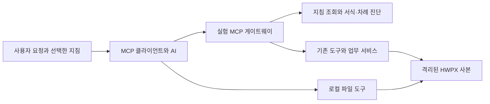

# HWPX MCP 실험 환경

운영 서버에 반영하기 전에 작업 성공률·지침 전달·문서 보존·전달량을 비교하는 독립 개발 경로입니다. 변경 파일은 이 디렉터리에만 있습니다. 기존 `server/`, `engine/`, 설치 `config.json`, 실제 `data/`를 수정하지 않으며 운영 서버를 재시작하지 않습니다.

실험 서버는 기존 문서 엔진과 업무 서비스를 불러오지만, 실행할 때마다 임시 설정·사용자·토큰·데이터 폴더를 새로 만듭니다. 입력 문서는 복사합니다. 서버의 모델 호출기는 비활성 스텁으로 대체되어 유료 모델 API를 호출하지 않습니다. 실제 추론은 연결한 MCP 클라이언트가 담당합니다.

**기존 코드와 이번 변경의 관계**

| 경로 | 기존 프로그램의 역할 | 실험 환경의 처리 |
|---|---|---|
| `server/mcp.js` | 문서 읽기, 제안, 표, 그림, 메모, 요청 처리 도구 | 같은 도구 구현과 권한 검사를 재사용 |
| `server/service.js`, `server/store.js`, `engine/` | 선점·시도 번호·정책 검사, HWPX 수정·저장·이력 | 임시 저장소를 대상으로 그대로 사용 |
| `server/index.js`, `server/mcp-modern.js` | 운영 HTTP, 기존 및 새 MCP 프로토콜 연결 | 실행하지 않음. 별도 `http.mjs`와 `serve.mjs` 사용 |
| `server/bridge.js` | 로컬 stdio 연결, 요청 알림, PC 파일과 서버 사이 바이트 전송 | 독립 stdio 및 로컬 파일 복사 경로 제공. 기존 알림 채널은 이번 실험 범위 밖 |
| `server/work-files.js` | Work용 HTTPS 파일 링크와 결과 파일 수신 | 공개 HTTPS가 없는 로컬 실험에서는 해당 도구를 숨기고 로컬 파일 도구 제공 |
| `server/ai.js`, `server/api-mcp-tools.js` | 서버가 모델 API를 호출하는 실행 경로 | 이번 실험에서는 사용하지 않음 |

기존에도 파일 전송과 도구 실행 기능이 있습니다. 이번 변경은 이 기능을 대체하는 새 문서 엔진이 아니라, 필요한 도구·문맥만 노출하고 진단·검증을 추가하는 MCP 계층입니다.



**구현한 작업 방식**

| 작업 | 실행 경로 | 전달량·정확도 개선 |
|---|---|---|
| 간단한 문장 수정 | `claim_next_request → propose_changes → complete_request` | 요청에 포함된 대상·문맥이 충분하면 문서 전체를 다시 읽지 않음 |
| 개인 지침으로 검토 | `get_task_guidance → add_memo` 또는 수정 제안 | 선택 지침의 이름·버전·해시를 먼저 받고 필요한 본문·참조만 페이지로 읽음 |
| 표 생성·수정 | `enable_tools(tables) → propose_table/propose_table_edit` | 기존 표 구조·모양 기능 유지 |
| 보고서·결론 작성 | `enable_tools(writing) → get_writing_guide → propose_insert` | 필요한 근거와 서식을 읽고 여러 문단을 한 번에 제안 |
| SVG·차트 그림 | `render_figure_preview → propose_rendered_figure` | 미리보기에서 서버에 보관한 원본을 `artifact_id`로 재사용 |
| 기존 그림 수정 | `list_figures → export_figure → 파일 처리 → propose_figure(replace_ref)` | 원본 다운로드·결과 업로드는 파일 바이트로 전달. SVG 수정도 artifact 경로 사용 가능 |
| 본문 서식 균일화 | `audit_formatting → propose_format_normalization` | 지정 기준과 다른 문단만 그룹으로 반환하고 일괄 제안 |
| 차례 새로고침·서식 복구 | `inspect_toc → propose_safe_toc_refresh` | 제목 수집 설정, 잘못된 제목 스타일, 차례 자체의 스타일·직접 서식을 구분 |
| 복합 작업 | 본문·서식 제안 → 차례 예약 → 완료 → 결과 확인 | 같은 요청에서 본문을 반영한 다음 차례를 갱신 |

AI는 사용자 의도와 지침을 해석하고 도구를 선택합니다. 파일 복사·그림 렌더·서식 비교·제안 적용 순서는 코드가 처리합니다. UI에서 대상과 동작이 이미 확정된 명령은 동일 MCP 도구를 직접 호출할 수도 있습니다. 이를 위해 별도 모델 API를 추가할 필요는 없습니다.

최초에는 13개 핵심 도구를 제공합니다. `enable_tools({groups:["formatting","toc"]})`처럼 필요한 그룹을 추가하면 `notifications/tools/list_changed`를 보내고 클라이언트가 `tools/list`를 갱신합니다. 전체 실험 도구 69개를 처음부터 제공하는 `--profile full`도 지원합니다. 도구를 적게 만드는 것이 목적이 아니라, 기능을 유지하면서 해당 작업에 필요한 정의만 모델에 전달하는 실험입니다.

**프로토콜 호환 범위:** 현재 설치된 SDK는 `1.32.1`, 최신 협상 버전은 `2025-11-25`입니다. 위 동적 목록은 이 범위에서 시험했습니다. `2026-07-28`의 새 규격은 연결별 상태나 다른 호출의 부작용으로 도구 목록을 바꾸는 방식을 허용하지 않습니다. 최신 규격으로 옮길 때는 목록을 고정하고 클라이언트에서 도구 검색·선별을 하거나 고정 프로필로 나누어야 합니다. 이 실험 서버는 운영의 새 프로토콜 어댑터를 구현했다고 주장하지 않습니다. [2025-11-25 도구 규격](https://modelcontextprotocol.io/specification/2025-11-25/server/tools), [2026-07-28 도구 규격](https://modelcontextprotocol.io/specification/2026-07-28/server/tools).

**빠른 실행**

저장소 루트에서 기존에 설치된 Node.js 의존성을 사용합니다.

```powershell
# 전체 자동 시험
npm --prefix experiments/mcp-lab test

# 실제 HWPX 결과와 JSON 측정 보고서 생성
node experiments/mcp-lab/scenarios.mjs
node experiments/mcp-lab/formatting-experiment.mjs

# 명시적으로 선택한 실제 스킬의 전송·페이지 복원 확인
node experiments/mcp-lab/verify-guidance.mjs "%USERPROFILE%\.codex\skills\conduct-education-research"

# 별도 loopback HTTP 서버. 임의의 빈 포트 사용
node experiments/mcp-lab/serve.mjs --port 0

# 로컬 MCP 클라이언트가 프로세스로 실행하는 stdio 연결
node experiments/mcp-lab/serve.mjs --stdio
```

실행 결과에는 임시 `work_dir`, `connection_file`, 문서·요청 ID가 나옵니다. HTTP 주소와 해당 실험 전용 bearer token은 `connection.json`에 있습니다. stdio의 안내는 stderr에만 기록합니다. HTTP는 `127.0.0.1`에만 바인딩하고 운영 포트 8787을 거절합니다. 수동 실행의 임시 폴더는 종료 후에도 결과 확인용으로 남깁니다. 자동 시험은 자신이 만든 임시 폴더를 정리합니다.

두 명령의 목적은 다릅니다. `npm ... test`는 자동 시험을 실행한 뒤 종료합니다. `serve.mjs --stdio`는 MCP 클라이언트와 표준 입출력으로 통신할 서버를 실행합니다. 터미널에서 단독 실행하면 시작 JSON 뒤에 입력을 기다리며, 웹 화면이나 AI 작업이 저절로 시작되지 않습니다. 실제 사용 시 클라이언트의 MCP 서버 설정에 이 실행 명령을 등록해야 합니다. 단독 실행 확인만 마쳤다면 `Ctrl+C`로 종료할 수 있습니다. `selected_skills:[]`는 해당 실험 요청에 서버가 전달할 개인 스킬을 등록하지 않았다는 뜻입니다.

동적 도구 갱신을 지원하지 않는 클라이언트는 `--profile full`로 실행하세요. 원격 ChatGPT/Work가 이 PC의 `127.0.0.1` 주소나 로컬 파일 경로에 접근할 수 있는 것은 아닙니다. 공개 연결·Work 파일 전송 통합은 후속 검증 대상입니다.

**교육연구 스킬과 문서 사본으로 실행**

```powershell
node experiments/mcp-lab/serve.mjs --stdio --profile focused `
  --document "D:\테스트자료\보고서.hwpx" `
  --skill-dir "%USERPROFILE%\.codex\skills\conduct-education-research" `
  --instruction "선택한 교육연구 지침으로 근거와 결론을 검토하고 수정안을 남겨줘."
```

`--document`를 생략하면 저장소의 시험용 HWPX를 복사합니다. `--skill-dir`는 명시적으로 선택한 디렉터리의 `SKILL.md`와 `references/`, `reference/` 아래 텍스트 참조만 등록합니다. 원본 문서·스킬은 수정하지 않습니다. MCP 서버가 클라이언트에 설치된 스킬을 자동으로 발견하는 방식은 아닙니다. 클라이언트 자체 스킬은 그 클라이언트가 읽거나 아래 등록 경로로 명시적으로 전달해야 합니다.

`get_request`에는 원래 사용자 지시와 선택 지침의 메타데이터가 실립니다. AI는 `get_task_guidance`의 `skill`, `reference`, `guidance` 뷰를 읽고 `next_offset`이 있으면 이어 읽습니다. 긴 지침을 몰래 자르지 않습니다. 지침은 사용자·요청별로 분리되며 등록·선택은 실행기 또는 인증된 제어 경로에서만 가능합니다. 모델 도구에 임의 스킬 경로를 여는 기능은 없습니다.

HTTP 실험 제어 경로는 모두 해당 임시 bearer token을 요구합니다(`/health` 제외).

| 경로 | 용도 |
|---|---|
| `POST /lab/documents/import` | HWPX 원본 바이트를 사본으로 등록 |
| `GET /lab/documents` | 본인에게 보이는 실험 문서 목록 |
| `POST /lab/documents/:id/requests` | 기존 요청 형식으로 작업 생성, 실행 경로는 queue로 고정 |
| `POST /lab/skills` | `{name,version,source,instructions,references:[{id,name,text}]}` 등록 |
| `POST /lab/guidance` | `{doc_id,request_id,user_instruction,selected_skills:[skill_id],guidance}` 선택. 원래 요청 지시와 일치해야 함 |
| `GET /lab/documents/:id/file` | 결과 HWPX 다운로드 |
| `GET /lab/metrics` | 같은 사용자의 최근 세션 전달량·오류·시간 기록 |
| `/mcp` | 기존 방식 Streamable HTTP MCP 연결 |

이 HTTP 경로는 테스트 준비·결과 수집용입니다. 새 모델 API 실행 경로가 아닙니다.

**서식과 차례를 고치는 기준**

서식은 세 층으로 구분합니다. `styleId`가 문단 역할을 나타내고, `paraPrId`는 문단모양, 각 run의 `charPrId`는 글자모양을 가리킵니다. 스타일 이름만 같아도 직접 지정한 글자·문단 서식이 달라 보일 수 있습니다. 반대로 글자가 크게 보여도 제목 스타일이 아니면 스타일 기반 차례에서 빠질 수 있습니다.

`audit_formatting`은 기준 문단 `reference_ref`, 기대 스타일 `expected_style`, 역할별 `roles`를 받을 수 있습니다. 기준을 주지 않으면 각 문단의 기존 스타일에서 벗어난 직접 서식을 검사합니다. 문서에서 가장 흔한 서식을 정답으로 간주하거나 모든 문단을 본문 스타일로 바꾸지 않습니다. 기준 문단과 스타일 ID는 먼저 `get_formatting`으로 확인합니다.

예를 들어 문서에서 확인한 스타일 ID가 `2`이고 대상이 `s0/p2`일 때:

```json
{"doc_id":"DOC","refs":["s0/p2"],"expected_style":{"id":"2"}}
```

위 인수로 `audit_formatting`을 호출하고, 받은 `audit_id`로 제안합니다.

```json
{"doc_id":"DOC","request_id":1,"expected_attempt":1,"audit_id":"AUDIT","reset_direct_overrides":true}
```

`reset_direct_overrides:true`는 의도적으로 글자·문단 직접 서식을 기준에 맞추는 선택입니다. 강조 표시가 필요한 영역까지 무조건 초기화하지 않도록 범위를 지정합니다. 진단 이후 문서 바이트나 버전이 바뀌면 재진단이 필요합니다. 결과가 여러 페이지이면 다음 참조 페이지도 읽어야 합니다.

차례는 `inspect_toc`에서 실제 필드 설정과 수집 스타일, 명시한 `heading_roles`, 차례 출력 스타일을 검사합니다. `toc_styles`에 문서에 실제 존재하는 `title/level1/level2/level3/captions` 이름을 지정하거나 `use_canonical_styles:true`로 기존 엔진의 차례 스타일 명칭을 검사할 수 있습니다. 잘못된 본문 제목은 먼저 교정하고, 차례 영역은 `propose_safe_toc_refresh(apply_styles:true)`의 전용 경로로 복구합니다.

복합 요청의 수정안이 아직 pending이면 `defer_until_applied:true`, `apply_now:false`, `request_id`, `expected_attempt`, `prerequisite_pids`로 같은 요청의 차례 갱신을 예약합니다. 선행 PID에는 같은 요청의 미반영 본문·서식 제안을 모두 포함해야 합니다. 예약 결과는 `refreshed:false`입니다. 자동 적용 정책은 `complete_request`에서 본문·서식 뒤 차례 순서로 적용하고, 수동 정책은 승인까지 pending으로 남깁니다. 완료 후에는 선행 제안과 차례 제안의 적용 상태 및 실제 내용을 다시 확인해야 합니다. 기존 서비스는 일부 제안 적용 실패 시 다른 제안을 계속 처리할 수 있으므로 요청 완료만으로 문서 전체 성공을 판단하지 않습니다.

없는 스타일 정의 생성, 중복 스타일 이름의 자동 결정, 기존 차례 필드의 수집 설정 변경은 이번 경로가 처리하지 않습니다. 원인을 반환하므로 잘못된 스타일을 임의로 대신 적용하지 않습니다. 한글의 실제 조판 결과·페이지 번호 정확도는 별도의 한글 렌더 확인 대상입니다.

**파일·그림과 토큰을 구분하는 법**

MCP의 도구 출력은 모델 API의 출력 토큰과 같은 개념이 아닙니다. AI가 생성한 도구 인수는 모델 출력이고, 서버가 반환한 내용을 다음 추론에 넣으면 모델 입력이 됩니다. 파일 전송 바이트와 모델이 읽는 입력은 구분해 측정해야 합니다.

| 전달 방식 | 이 실험의 처리 | 모델에 들어가는 내용 |
|---|---|---|
| 문서 읽기·검색 | 필요한 범위의 텍스트·구조만 반환 | 실제 반환 내용 |
| 파일 복사·결과 첨부 | 바이트를 직접 읽고 저장 | 경로·첨부 ID·크기·해시 |
| 그림 미리보기 | MCP `image` 블록과 artifact ID | 클라이언트가 모델에 전달하면 이미지 입력 |
| 미리보기 뒤 삽입 | 같은 세션의 artifact ID 사용 | SVG·차트 원본을 다시 생성할 필요 없음 |
| 원격 파일 링크 | 운영 Work 경로의 별도 기능 | 링크를 보여주는 것과 파일 내용을 모델이 읽는 것은 다른 작업 |

`download_attachment_file`과 `upload_result_file`은 요청·시도·선점과 사용자 전용 작업 폴더를 검사합니다. 다운로드 응답의 `out_dir`에 클라이언트 도구로 결과 파일을 만들고 업로드하면 첨부 `aid`를 받습니다. 그림은 그 `aid`를 `propose_figure`에 전달합니다. 파일 전체를 모델 출력에 Base64 문자열로 적을 필요가 없습니다. 로컬 경로는 서버와 같은 파일시스템에 접근 가능한 클라이언트에만 유효합니다.

이미지를 URL로 전달해도 모델이 이미지를 읽으면 이미지 입력 비용이 생깁니다. PDF 파일도 본문과 페이지 이미지가 모델 문맥에 들어갈 수 있습니다. 따라서 파일 링크 자체가 토큰 무료화를 의미하지 않습니다. [OpenAI 이미지 입력 설명](https://developers.openai.com/api/docs/guides/images-vision), [OpenAI 파일 입력 설명](https://developers.openai.com/api/docs/guides/file-inputs).

현재 그림 캐시는 SVG·차트 원본 재전송을 줄입니다. 최종 문서용 300dpi 렌더 자체를 없애지는 않습니다. 사진·삽화 생성이나 의미 있는 이미지 수정은 연결한 클라이언트의 이미지 도구가 수행해야 하며 실험 서버에 생성 모델을 추가하지 않았습니다. 지침·진단·그림 캐시는 실행/세션 수명에 묶여 있으므로 새 실행에서는 다시 등록·검사·렌더해야 합니다.

**측정 결과와 검증 범위**

결과 원문은 [scenarios-report.json](artifacts/scenarios-report.json), [formatting-report.json](artifacts/formatting-report.json), [real-guidance-report.json](artifacts/real-guidance-report.json)에 있습니다. 측정은 JSON 직렬화 문자 수와 바이트 수이며 모델 토큰은 `null`로 기록합니다. HTTP 계측에도 사용자 본문·지침·토큰은 저장하지 않습니다.

| 비교 | 전체 실험 프로필 | 최초 focused 프로필 | 감소 |
|---|---:|---:|---:|
| 도구 목록 | 69개 / 94,349자 | 13개 / 16,115자 | 약 82.9% |
| 동일 시험 요청 응답 | 5,157자 | 2,765자 | 약 46.4% |

기존 기본 도구 정의는 실험 서비스에서 61개 / 83,292자이며, 이 기준 대비 최초 목록 감소는 약 80.7%입니다. 비교 요청의 9개 문단과 사용자 지시는 그대로 유지했습니다. 이 수치는 해당 고정 시험 입력의 결과이고 실제 고객의 누적 비용 절감률이 아닙니다. 필요 그룹을 추가하면 목록이 커지며, 클라이언트의 도구 검색·캐시 정책에 따라 모델 입력량도 달라집니다. 시나리오 계측의 호출 수·시간에는 시험 문서 준비 호출도 포함됩니다.

자동 실험은 간단 문장 수정, 교육연구 검토 메모, 표 수정, 그림 생성·교체·재시도, 보고서·결론 저장, 제목 역할·직접 서식 교정, 차례 출력 서식 복구를 포함합니다. 저장한 HWPX를 다시 열어 텍스트·표·그림·스타일을 확인합니다. 실제 교육연구 스킬의 `SKILL.md`와 참조 6개도 페이지를 이어 읽은 결과가 원본과 정확히 일치함을 확인했습니다.

개발 중 실행한 단위·통합시험은 합계 45개가 통과했습니다(격리 2, 지침 6, 그림 10, 서식·차례 13, 로컬 파일 4, 게이트웨이 4, HTTP 3, stdio 1, 작업 시나리오 2). 독립 검증 담당자가 최종 연결 변경 후 HTTP·stdio·시나리오 6개를 확인하고, 추가 HTTP 점검으로 파일 바이트 왕복·다른 세션 선점 차단·다른 사용자 세션 차단·원본 보존·full 도구 동등성을 확인했습니다. 세부 기록은 [verification-report.json](artifacts/verification-report.json)에 있습니다.

교육연구 검토 시나리오는 명시된 시험 지침과 결정된 도구 호출로 실행합니다. 실제 스킬 전송 검증도 내용 일치 검사입니다. AI가 지침을 해석해 좋은 연구 검토·결론을 작성하는지는 아직 평가하지 않았습니다. 외부 클라이언트 연결 시 같은 사본과 요청을 focused/full로 각각 실행하고, 지침 준수·요구 항목 충족·불필요한 수정·재시도·전체 소요 시간·클라이언트가 제공한 실제 usage를 함께 기록해야 합니다.

운영 반영은 자동화하지 않았습니다. 기능별로 회귀시험, 실제 클라이언트 호환성, 개인 지침에 따른 결과 품질, 한글에서 결과 파일 확인을 통과한 변경만 분리해 승격할 수 있습니다. 특히 동적 도구 목록은 사용하려는 MCP 버전과 클라이언트에서 먼저 검증해야 합니다.
